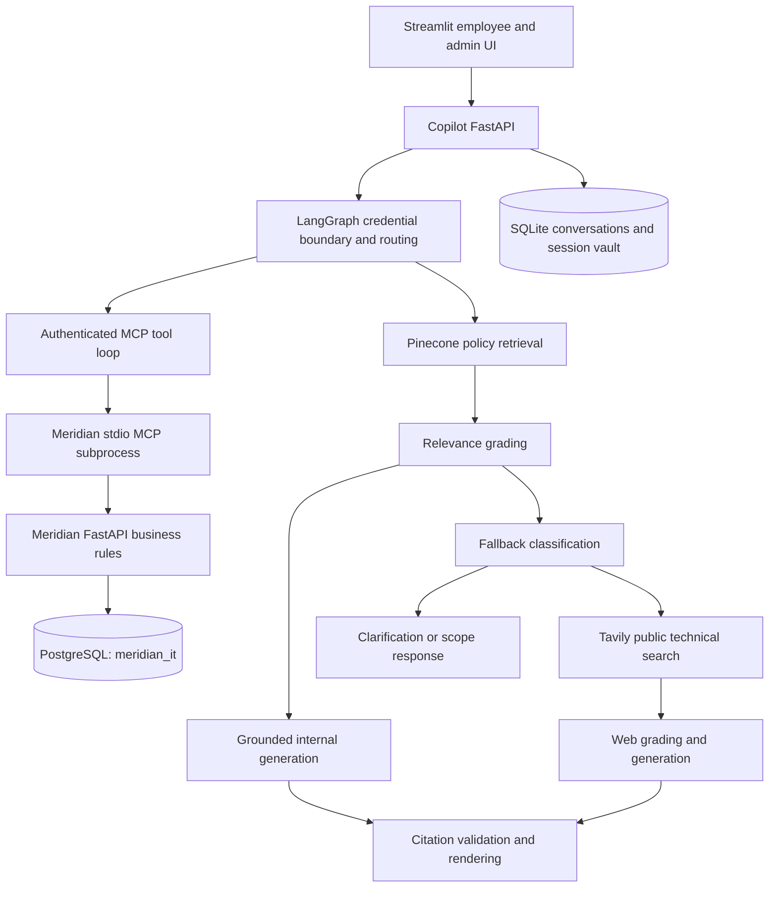

# Enterprise IT Support Copilot

An IT support assistant with grounded policy answers, employee self-service
tickets, persistent conversations and an admin workspace. Built with LangGraph,
FastAPI, Streamlit, MCP, SQLAlchemy and PostgreSQL.

This local development project uses a **synthetic Meridian Logistics knowledge
base**. The completed historical knowledge benchmark scored **83/98 passed,
15 failed**; its strict quality gate fails. It is not production-certified.

## Features

- Employees sign in with email/password and search, rename, archive and reopen
  chats. They create their own tickets and close them when they fix the problem.
- Employees edit ticket title/description before admin review. Admin opening of
  ticket details locks edits; browsing the queue does not. Further clarification
  requires a new ticket. Other status changes remain admin-only, with history.
- Admins manage employees, devices and tickets through a dashboard or admin
  chat. Chat mutations require a review card and explicit confirmation.
- Policy answers cite supplied sources. Public technical gaps can use web search;
  company-specific gaps ask for clarification. Matched secret requests/offers are
  refused before tools or model calls.
- Durable ticket idempotency protects retries. Login supports refresh, logout
  revocation and browser-refresh restoration in Docker.

## Architecture



One provider adapter serves grading, classification, generation and tool planning.
It supports Groq, Gemini, OpenAI, Ollama and configured compatible endpoints;
adapter support does not mean every provider/model has passed live validation.
Generated claims carry explicit source IDs, validated before rendering citations.
Source linkage does **not** establish semantic support for every claim.

Backend permissions use authenticated identity, independent of model output.
MCP starts on demand inside the Copilot container and carries the user's token to
Meridian REST. PostgreSQL stores business records and authentication data. A named
SQLite volume stores conversations, pending actions and encrypted browser-session
credentials; the browser receives an opaque HttpOnly session cookie.

```text
app/           LangGraph, retrieval, generation, Copilot API, evaluations
ui/            Streamlit login, chat and admin dashboard
backend/       Meridian REST API, MCP bridge, ORM, Alembic and tests
data/          Synthetic policy documents
evals/         Knowledge catalog and workflow expectations
scripts/       Setup, provider switching and integration verification
docs/          Design, operational guides and investigation findings
```

Both Python services have an `app` package. Run Meridian from `backend/` and
Copilot from the repository root, with separate virtual environments. They
communicate through REST/MCP.

## Docker setup on Windows

Prerequisites: Python 3.12 for host tools and Docker Desktop running with Linux
containers. Run in CMD from a fresh checkout:

```bat
cd /d C:\ITSupportCopilot
python -m venv .venv
.venv\Scripts\activate
python -m pip install -r requirements.txt
if not exist .env copy .env.example .env
```

Fill private `.env`: select `LLM_PROVIDER` and an account-accessible `LLM_MODEL`,
set its provider key, and configure `PINECONE_API_KEY`, `PINECONE_INDEX_NAME` and
`TAVILY_API_KEY`. The latest validated Docker selection was `gemini` /
`gemini-3.5-flash-lite`; model availability depends on your account. Never paste
keys into chat or commit environment files.

For a **new** Pinecone index, create the integrated embedding index, wait for it
to become ready, then ingest the supplied synthetic policies:

```bat
python -m app.create_index
python -m app.ingestion.ingest_documents
```

Ingestion uploads policy text to namespace `meridian-logistics` and may incur
provider usage. Existing configured indexes need not be re-ingested.

```bat
python scripts\init_docker_env.py
docker compose --env-file .env.docker config --quiet
docker compose --env-file .env.docker up --build -d --wait
docker compose --env-file .env.docker ps -a
```

Initialization copies provider configuration and generates independent Docker
credentials in ignored `.env.docker`. Existing credentials are preserved. Do not
regenerate database credentials for an existing volume. Successful migrations
exit with code 0; the other four services should be healthy.

| Service | Default address | Last verified local override |
| --- | --- | --- |
| Copilot UI | http://localhost:8501 | http://localhost:8502 |
| Copilot API | http://localhost:8001/docs | Same |
| Meridian API | http://localhost:8000/docs | http://localhost:8002/docs |
| PostgreSQL 18 | Internal `postgres:5432` | No host port |

If ports are occupied, set `MERIDIAN_PORT=8002`, `STREAMLIT_PORT=8502` and
`COPILOT_PUBLIC_URL=http://localhost:8502` in `.env.docker`, then run `up -d --wait`
again. `COPILOT_PORT` can also be overridden. Do not stop Docker/WSL processes to
free ports. A missing `dockerDesktopLinuxEngine` pipe means Docker Desktop's
Linux engine is not running.

### First admin and employee login

For a fresh Docker database, issue a private, single-use browser setup link:

```bat
docker compose --env-file .env.docker exec meridian python scripts/create_admin_setup.py --email admin@example.com --full-name "Local Admin" --public-url http://localhost:8502
```

Use `8501` if using the default UI port. Open the printed private link, choose a
password, then select **Admin login**. The link expires after 24 hours; do not
share or screenshot it. Existing logins are not reset or promoted. Use the admin
dashboard to create employees and issue their setup links. Employees choose
passwords in the browser and select **Employee login**. The Docker database does
not automatically import earlier Windows data.

For local setup without Docker, follow [backend setup](backend/README.md) and
[integration commands](docs/meridian-integration.md). Guides cover
[browser login](docs/browser-login.md), [admin chat](docs/admin-chat.md),
[ticket review](docs/ticket-review.md), [idempotency](docs/ticket-idempotency.md)
and [provider switching](docs/llm-providers.md).

### Stop and update

```bat
docker compose --env-file .env.docker down
docker compose --env-file .env.docker up --build -d --wait
```

Named database and chat volumes survive ordinary `down` and recreation. Removing
volumes deletes their data. Back up before migrations or storage changes. Use
`config --quiet`; full resolved Compose configuration contains credentials.

## Screenshots

Actual screenshots are pending. Capture of the running sign-in and API pages
was blocked on 2026-11-10 because browser automation could not confidently verify
the current URL. No mockups are presented as screenshots. The links above open
the real application; captures should exclude account details and setup tokens.

## Verification

```bat
python -m unittest discover -s tests -q
python -m app.evaluation.scorecard --profile offline --output evals/reports/offline
python -B scripts\verify_compose.py --live-model --credential-contract
```

Unit/runtime checks mock providers. The final command uses running Docker, real
API/database/MCP operations and a live model identity lookup; it consumes provider
tokens and creates temporary fixtures, then cleans them up. It checks permissions,
review locks, closure/history, credential refusals, chat restoration and logout
revocation. Omit `--live-model` to avoid the live model call.

[GitHub Actions](https://github.com/rushberry02/enterprise-it-support-copilot/actions/workflows/evaluations.yml)
runs offline checks on pushes/PRs. Live knowledge runs require manual opt-in and
configured secrets. The `checks` scorecard profile additionally requires the
backend virtual environment and real PostgreSQL; see [evaluations](docs/evaluations.md).

## Evaluation results

Observed as of **2026-11-10**:

| Evidence | Result | Scope and limitation |
| --- | --- | --- |
| Frozen historical knowledge baseline | **83/98 passed; 15 failed**, no errors/skips | Mixed Groq/Gemini and revisions; strict gate fails; not a provider comparison |
| Current root unit suite | **177 passed** | Offline regressions, not live-model quality |
| Current scripted runtime scorecard | **20/20 passed** | Specified model outputs and injected faults |
| Final Docker end-to-end smoke | **Passed** | Live model/MCP/REST/PostgreSQL lookup and scoped workflows, not all knowledge cases |
| Credential cases 087/090/098 | **3/3 passed** | Compiled graph, zero provider calls, unchanged expectations |
| Reviewed policy cases 054/072, revision 2 | **2/2 passed** | Targeted Gemini run; changed expectations, not a comparable baseline gain |
| Routing cases 014/043 | **6 offline tests passed** | Controlled scenarios; original live failures and hashes unchanged |

Historical reports were frozen with checksums. Targeted results remain separate
and do not replace historical failures. Generated reports stay local under ignored
`evals/reports/`; tracked investigation notes record findings and scope. Read
[answer-quality findings](docs/answer-quality-investigation.md),
[credential/policy review](docs/credential-policy-followup.md) and
[routing investigation](docs/routing-investigation.md).

Remaining work includes routing-contract decisions, diagnosis of older
`insufficient_context` outcomes, and targeted checks of remaining citation
failures. No new full 98-case benchmark was run for this update.

## Development limits

Application ports bind to localhost. Production HTTPS, backup/restore operations,
monitoring, scale testing and deployment governance need additional work. External
model, Pinecone and Tavily calls can transmit content outside the local machine.
The credential text guard has bounded language/pattern coverage and does not erase
earlier stored chat text. Trusted login credentials travel outside chat, but users
can still submit secrets in chat; avoid doing so. Keep `.env*`, tokens, checkpoint
databases and private reports out of Git.
